# Replication script for the 4Smethod

This vignette illustrates how to replicate the **4S methodology**
following the steps described Saulnier et al. (202? - preprint :
arXiv:2407.08278). The 4S method is a comprehensive strategy in four
consecutive steps to analyze the repeated item data of multidimensional
measurement scales or questionnaires in longitudinal studies.

The 4S method successively  
(**1**) structures the scale into subdimensions satisfying three
calibration assumptions (unidimensionality, conditional independence,
increasing monotonicity),  
(**2**) describes each subdimension progression using a joint latent
process model (**JLPM**) which includes a continuous-time item response
theory model for the longitudinal subpart,  
(**3**) aligns each subdimension’s progression with disease stages
through a projection approach,  
(**4**) identifies the most informative items across disease stages
using the Fisher information.

## Importation

The following libraries are used in this vignette:

``` r
library(ggplot2) # data description plots
library(ggalluvial) # sankeyplot
library(psych) # step 1 : EFA  # version prior 2.0 required 
library(polycor) # step 1 : polychoric correlation matrix
library(lavaan) # step 1 : CFA
library(mokken) # step 1 : check monotonicity
library(plot.matrix) # step 1 : plot colored matrix
library(fmsb) # step 2 : plot spiderchart
library(survival) # data description : Kaplan Meier
library(JLPM) # steps 2 and 3 : model estimation
```

## Dataset

The illustration is on a simulated dataset.

``` r
load("simulated_data.RData")
```

The dataset is a simulated sample of N=**700 patients** with K=**11
5-level items** measured at repeated annual visits from 0 to 10 years,
and a time-to-event collected in continuous time.

The data.frame is in longitudinal format with **2762 rows**
corresponding to the follow-up visits of the **700** patients, and **17
columns** corresponding to the different variables:

- **ID** the identification number of the patient
- **t** the time of measurement (years in the study)
- **X** a binary time-independent covariate
- **item*k*** the item k with level in {0, 1, 2, 3}
- **stage** the disease stage (0 to 4)
- **T** the minimum time between the event or censoring occurrence
- **D** the indicator of event or censoring

``` r
N <- length(unique(data$ID)) # nb individuals
K <- 11 # nb of items
nl <- 5 # nb of levels

str(data)
#> 'data.frame':    2762 obs. of  17 variables:
#>  $ ID    : num  1 1 1 1 2 3 3 3 3 3 ...
#>  $ t     : num  0 0.883 1.936 3.036 0 ...
#>  $ X     : int  1 1 1 1 1 0 0 0 0 0 ...
#>  $ item1 : int  2 1 1 2 2 0 1 3 1 1 ...
#>  $ item2 : int  1 2 1 2 2 1 1 1 0 0 ...
#>  $ item3 : int  3 3 4 4 2 2 2 1 3 3 ...
#>  $ item4 : int  1 2 2 4 1 2 2 1 3 1 ...
#>  $ item5 : int  3 3 4 4 2 1 2 3 2 2 ...
#>  $ item6 : int  1 0 0 0 0 2 3 2 3 2 ...
#>  $ item7 : int  0 0 0 0 1 0 0 1 0 2 ...
#>  $ item8 : int  0 0 0 0 0 1 1 2 2 2 ...
#>  $ item9 : int  1 0 0 0 2 2 2 3 2 3 ...
#>  $ item10: int  1 0 0 0 1 2 3 3 3 2 ...
#>  $ item11: int  1 0 0 0 0 2 2 2 2 2 ...
#>  $ stage : int  2 4 4 5 1 3 3 2 2 3 ...
#>  $ T     : num  3.646 3.646 3.646 3.646 0.644 ...
#>  $ D     : num  1 1 1 1 1 0 0 0 0 0 ...
```

### Description of the sample at baseline

``` r
data0 <- data[which(data$t==0),]
summary(data0)
#>        ID              t           X              item1           item2      
#>  Min.   :  1.0   Min.   :0   Min.   :0.0000   Min.   :0.000   Min.   :0.000  
#>  1st Qu.:175.8   1st Qu.:0   1st Qu.:0.0000   1st Qu.:1.000   1st Qu.:1.000  
#>  Median :350.5   Median :0   Median :1.0000   Median :1.000   Median :1.000  
#>  Mean   :350.5   Mean   :0   Mean   :0.7229   Mean   :1.367   Mean   :1.144  
#>  3rd Qu.:525.2   3rd Qu.:0   3rd Qu.:1.0000   3rd Qu.:2.000   3rd Qu.:2.000  
#>  Max.   :700.0   Max.   :0   Max.   :1.0000   Max.   :4.000   Max.   :4.000  
#>      item3           item4           item5           item6       
#>  Min.   :0.000   Min.   :0.000   Min.   :0.000   Min.   :0.0000  
#>  1st Qu.:2.000   1st Qu.:0.000   1st Qu.:1.000   1st Qu.:0.0000  
#>  Median :2.000   Median :1.000   Median :2.000   Median :1.0000  
#>  Mean   :2.163   Mean   :1.219   Mean   :1.717   Mean   :0.9471  
#>  3rd Qu.:3.000   3rd Qu.:2.000   3rd Qu.:2.000   3rd Qu.:1.0000  
#>  Max.   :4.000   Max.   :4.000   Max.   :4.000   Max.   :4.0000  
#>      item7            item8          item9           item10     
#>  Min.   :0.0000   Min.   :0.00   Min.   :0.000   Min.   :0.000  
#>  1st Qu.:0.0000   1st Qu.:0.00   1st Qu.:1.000   1st Qu.:1.000  
#>  Median :0.0000   Median :1.00   Median :2.000   Median :2.000  
#>  Mean   :0.4757   Mean   :0.99   Mean   :1.657   Mean   :1.817  
#>  3rd Qu.:1.0000   3rd Qu.:2.00   3rd Qu.:2.000   3rd Qu.:2.000  
#>  Max.   :3.0000   Max.   :4.00   Max.   :4.000   Max.   :4.000  
#>      item11           stage             T                  D         
#>  Min.   :0.0000   Min.   :1.000   Min.   : 0.02081   Min.   :0.0000  
#>  1st Qu.:0.0000   1st Qu.:2.000   1st Qu.: 1.72060   1st Qu.:0.0000  
#>  Median :1.0000   Median :2.000   Median : 2.97674   Median :1.0000  
#>  Mean   :0.9114   Mean   :2.533   Mean   : 3.46497   Mean   :0.6629  
#>  3rd Qu.:1.0000   3rd Qu.:3.000   3rd Qu.: 4.70674   3rd Qu.:1.0000  
#>  Max.   :4.0000   Max.   :5.000   Max.   :10.00000   Max.   :1.0000
```

### Items’ observed individual trajectories

``` r
par(mfrow=c(3,4), mar=c(4,4,3,1))

for(k in 1:K){  # for each item
  
  plot(x = data$t[which(data$ID == 1)], 
       y = data[which(data$ID == 1),paste("item",k,sep="")],
       xlim = c(0,10), ylim = c(0,nl-1), type = "l", lwd = 1,
       main=paste("item",k,sep=""), xlab = "Years", ylab = "Level",
       bty = "n", las = 1, cex.main = 1.5,
       cex.axis = 1, axes = TRUE)
  for(i in 2:N)
    lines(x = data$t[which(data$ID == i)], 
          y = data[which(data$ID == i),paste("item",k,sep="")], 
          lwd = 1, lty = 1)
  
}
```


### Stage distribution over time

``` r
data$t_rounded <- round(data$t)
data$stage_factor <- factor(data$stage, levels=5:1)

ggplot(data,
       aes(x = t_rounded, stratum = stage_factor, alluvium = ID, 
           fill = stage_factor, label = stage_factor)) +
  geom_flow() +
  geom_stratum(width = .45) +
  theme_light()  +
  scale_fill_manual(values = c("#08306B","#2171B5","#6BAED6","#C6DBEF","#F7FBFF")) +
  labs(y = "Nb of patients", x = "Years", fill = "Stage")
```

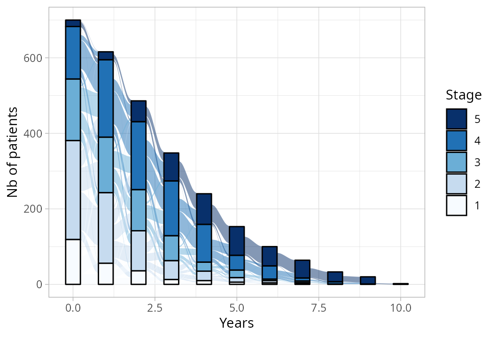

### Time to event

``` r
KM <- survfit(Surv(time = T, event = D) ~ 1, data = data0)

par(mar=c(4,4,1.5,1))
plot(KM,
     fun = "S", ylim = c(0,1), cex.axis = .8, cex.main = 1,
     bty="n", las = 1, xlab="Years", ylab="Probability",
     main = "Kaplan-Meier estimated survival function")
abline(h=.5,col="grey",lty=3,lwd=2)
abline(v=summary(KM)$table["median"],col="grey",lty=3,lwd=2)
```

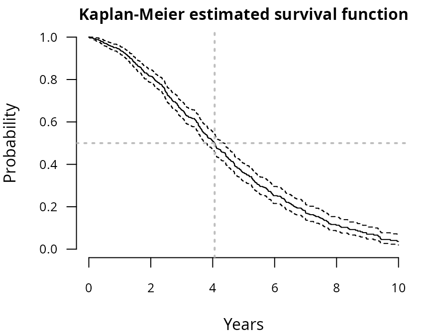 Among the
patients, **464 (66%)** experienced the event during the study, with a
survival median around **4.06** years.

## STEP 1 - Structuring

**Identification of the scale’s subdimensions**

The first preliminary step consists in structuring the measurement scale
into unidimensional subdimensions (also called latent traits) that
comply three central assumptions:

- *unidimensionality*: all the items of a subdimension should represent
  an homogeneous latent trait,
- *conditional independence*: the latent trait should capture the whole
  correlation across items with no remaining residual correlation
  between items,
- *increasing monotonicity*: higher item level should consistently
  reflect a higher underlying trait level.

We followed the recommended strategy reported by the PROMIS
(Patient-Reported Outcomes Measurement Information System) initiative in
Reeve et al. (2007) \[1\] for cross-sectional data. We adapted the
PROMIS method to longitudinal data by using a resampling strategy: we
randomly selected a single visit per subject to create a pseudo
independent sample of size N on which the PROMIS method could be used,
and we replicated this procedure multiple times to account for sampling
fluctuations.

Note that the three calibration assumptions may be successively
evaluated with stepbacks or systematic reevaluations to measure the
impact of certain decisions.

``` r
R <- 50 # number of replicates

seeds <- sample(x=1:1000,size=R)
```

Illustration on replicate 1:

``` r
r <- 1 # replicate

set.seed(seeds[r]) # seed

# random selection of one visit per patient
select <- sapply(X=table(data$ID), 
                 FUN=function(x){sample(1:x,size=1)})
data_r <- data[which(data$ID==1),][select[1],]
for(i in 2:N)
  data_r <- rbind(data_r,data[which(data$ID==i),][select[i],])
```

### Unidimensionality

Determine the optimal number of subdimensions and item assignment to
dimensions.

#### General EFA

An explanatory factorial analysis (EFA) is performed on all the item
data to identify the independent subdimensions measured by the scale.
The optimal number of subdimensions can be determined by dressing the
scree plot of the successive eigenvalues and chosen the largest either
as the largest number of factors with successive eigenvalues greater
than value 1 (Kaiser criterion), or identifying the “elbow” where the
eigenvalues begin to plateau (Cattell criterion). This analysis can be
carried out using function *fa.parallel()* from the R-package **psych**.

``` r
par(mar=c(4.5,4.5,2,0),cex=.8)
screeplot <- fa.parallel(data_r[,c(paste("item",1:K,sep=""))],
                         fm = 'minres', fa = 'fa', cor='poly', plot=TRUE)
```

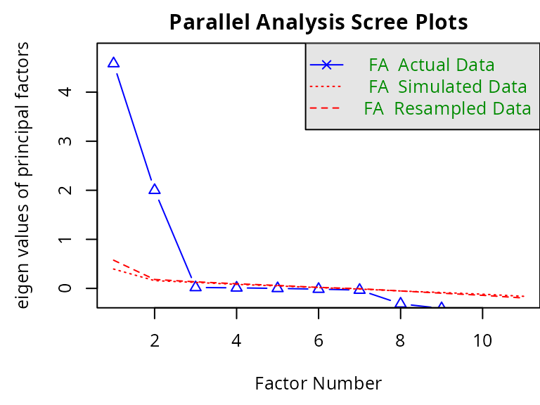

    #> Parallel analysis suggests that the number of factors =  2  and the number of components =  NA

Here, the analysis suggests 2 factors.

#### Polychoric correlation matrix

Items are assigned to the subdimension they contribute the most based on
factor loadings resulting from the polychoric correlation matrix, with
rotation maximizing within-factor variance (ensuring that each item is
strongly associated with its assigned dimension and weakly with others),
and representing the strength of association between the items and the
latent traits. We assume each item contributes to only one subdimension.
If the higher loading of an item is lower than 0.3, its contribution is
considered too small to be assigned to any subdimension.

``` r
pc <- hetcor(data_r[,c(paste("item",1:K,sep=""))], ML=TRUE)   
  
efa2 <- fa(r=pc$correlations, nfactors=2, rotate="varimax")

contrib2 <- data.frame(ITEM = paste("item",1:K,sep=""),
                       FACT1 = efa2$loadings[,2],
                       FACT2 = efa2$loadings[,1])
contrib2$max_loading <- apply(X=contrib2[,-1],MARGIN=1,FUN=max)
contrib2$FACTOR <- ifelse(contrib2$max_loading == contrib2$FACT1,1,2)
contrib2$FACTOR[which(contrib2$max_loading<.3)] <- NA

par(mar=c(4,4,2,1),cex=.8)
barplot(cbind(FACT1,FACT2)~ITEM,
        data=contrib2, beside=TRUE, col=c("blue","red"),
        space = c(.1,2),ylim=c(-.1,1.2), xlab = "item",
        las=1,names.arg=1:K,main="Items' contribution to 2 dimensions")
abline(h=0.3,lwd=2,lty=3,col="grey40") 
abline(h=0,lwd=2,lty=1,col="black")
legend(x="topright",legend=paste("dimension ",1:2,sep=""),col=c("blue","red"),pch=16,bty="n")
```

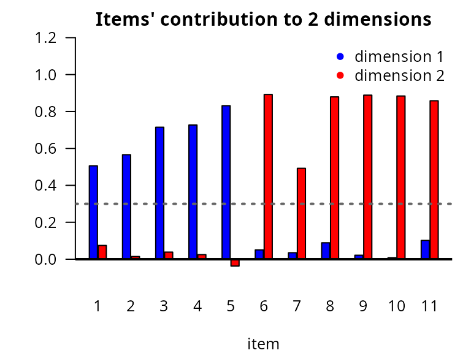 Item
assignment: dimension 1 (blue) with items 1 to 4 and dimension 2 (red)
with items 5 to 10.

#### EFA per dimension

At this stage, one EFA can be performed per subdimension to ensure only
one latent factor is highlighted.

``` r
par(mfrow=c(1,2),mar=c(4.5,4.5,2,0),cex=.5)
screeplot_dim1 <- fa.parallel(data_r[,paste("item",1:5,sep="")], 
                              fm = 'minres', fa = 'fa', cor='poly')
#> Parallel analysis suggests that the number of factors =  1  and the number of components =  NA
screeplot_dim2 <- fa.parallel(data_r[,paste("item",6:11,sep="")], 
                              fm = 'minres', fa = 'fa', cor='poly')
```

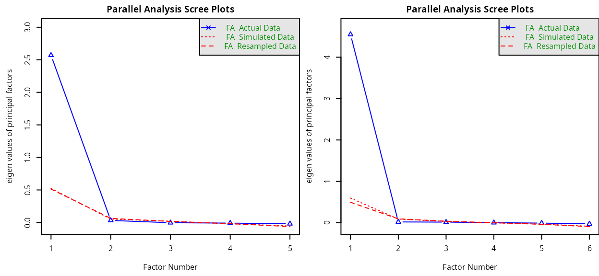

    #> Parallel analysis suggests that the number of factors =  1  and the number of components =  NA

The analysis concludes to 1 factor (i.e., unidimensionality) for both
dimensions.

#### CFA

A confirmatory factorial analysis (CFA) is performed on the identified
subdimensions to evaluate the model fit. According to Reeve et
al. (2007), the model fit is considered sufficient if the following
criteria are satisfied: comparative fit index (CFI) \> 0.95, Tucker
Lewis index (TLI) \> 0.95, root means square error of approximation
(RMSEA) \< 0.06, and standardized root mean square residual (SRMR) \<
0.08. CFI and TLI assess the fit between the estimated model and a null
model assuming no constraint on the structure. RMSEA and SRMR assess the
fit between the estimated model and the observed data. This analysis can
be carried out using function *cfa()* from the R-package **lavaan**.

``` r
rep2 <- paste(paste(" dim1 =~ ",paste(paste("item",1:5,sep=""),collapse="+"),"\n"),
              paste(" dim2 =~ ",paste(paste("item",6:11,sep=""),collapse="+")),sep="")

fit2 <- cfa(rep2, 
            data = data_r, 
            ordered = paste("item",1:K,sep=""))
fitMeasures(object=fit2,fit.measures=c("cfi","tli","rmsea","srmr"))
#>   cfi   tli rmsea  srmr 
#> 1.000 1.000 0.000 0.031
```

The fit criteria are respected.

### Conditional independence

The correlation matrix between the CFA predicted values and the
observations is reported to identify residual correlation. PROMIS
authors Reeve et al. (2007) \[1\] consider two items are substantially
correlated if their residual correlation exceeds 0.2. In case the two
correlated items are assigned to the same subdimension, one of them
should be removed, as considered as redundant and according to clinical
relevance.

``` r
N_cov <- list(
  observed=inspect(fit2, 'sampstat')$cov,
  fitted=fitted(fit2)$cov
)

N_cor <- list(
  observed=cov2cor(N_cov$observed),
  fitted=cov2cor(N_cov$fitted)
)

resid <- N_cor$observed - N_cor$fitted  # residuals
round(resid,1)
#>        item1 item2 item3 item4 item5 item6 item7 item8 item9 item10 item11
#> item1    0.0                                                              
#> item2    0.0   0.0                                                        
#> item3    0.0   0.0   0.0                                                  
#> item4    0.0   0.0   0.0   0.0                                            
#> item5    0.0   0.0   0.0   0.0   0.0                                      
#> item6    0.0   0.0   0.0   0.0  -0.1   0.0                                
#> item7    0.0   0.0   0.0   0.0  -0.1   0.0   0.0                          
#> item8    0.1   0.0   0.0   0.0   0.0   0.0   0.0   0.0                    
#> item9    0.0   0.0   0.0   0.0  -0.1   0.0   0.0   0.0   0.0              
#> item10   0.0   0.0   0.0   0.0  -0.1   0.0   0.0   0.0   0.0    0.0       
#> item11   0.1   0.0   0.1   0.0   0.0   0.0   0.0   0.0   0.0    0.0    0.0
```

Here, no redundancy is observed.

### Increasing monotonicity

The monotonicity is visually inspected for each item by plotting the
mean item levels by decile of the rest-score of the assigned
subdimension (i.e., sum-score of all the other items from the
subdimension except this one), or the item higher-level probabilities by
decile of the rest-score. Reeve et al. (2007) \[1\] recommend to
visually check that the curves are consistently increasing or at least
constant. This analysis can be carried out using function
*check.monotonicity()* from the R-package **mokken**.

``` r
monot_D1 <- check.monotonicity(data_r[,paste("item",1:5,sep="")],minsize=50)
monot_D2 <- check.monotonicity(data_r[,paste("item",6:11,sep="")],minsize=50)


par(mfrow=c(3,4),mar=c(4.5,4,1,4),cex=.5)
col <- c(gray(.8),gray(.6),gray(.4),gray(.2))

# dimension 1
for(i in 1:5){
  
  plot(y = monot_D1$results[[i]][[2]][,"P(X >=1)"], 
       x = monot_D1$results[[i]][[2]][,"Hi Score"],
       type = "l", col = col[1], ylim = c(0,1), xlim = c(0,(5-1)*(nl-1)), las = 1,
       bty = "l", xlab = "rest-score", ylab = "probability")
  mtext(text = paste("item",i,sep=""), cex = .5, side = 3, line = 0, font = 2, col = "blue")
  for(m in 2:4)
    lines(y = monot_D1$results[[i]][[2]][,paste("P(X >=",m,")",sep="")], 
          x = monot_D1$results[[i]][[2]][,"Hi Score"], col = col[m])
  par(new=TRUE)
  plot(y = monot_D1$results[[i]][[2]][,"Mean"], x = monot_D1$results[[i]][[2]][,"Hi Score"], 
       lwd = 2, type = "l", col = "black", lty = 2, xlim=c(0,(5-1)*(nl-1)), ylim=c(0,nl-1),
       xlab="",ylab="",yaxt="n",bty="l",legend=NULL,cex.lab=1.5,cex.axis=1.5,axes = F)
    axis(4, line=0, las=1); mtext(text = "response", cex = .5, side = 4, line = 2.5)
  
}

# dimension 2
for(i in 1:6){
  
  plot(y = monot_D2$results[[i]][[2]][,"P(X >=1)"], 
       x = monot_D2$results[[i]][[2]][,"Hi Score"],
       type = "l", col = col[1], ylim = c(0,1), xlim = c(0,(6-1)*(nl-1)), las = 1,
       bty = "l", xlab = "rest-score", ylab = "probability")
  mtext(text = paste("item",5+i,sep=""), cex = .5, side = 3, line = 0, font = 2, col = "red")
  for(m in 2:4)
    lines(y = monot_D2$results[[i]][[2]][,paste("P(X >=",m,")",sep="")], 
          x = monot_D2$results[[i]][[2]][,"Hi Score"], col = col[m])
  par(new=TRUE)
  plot(y = monot_D2$results[[i]][[2]][,"Mean"], x = monot_D2$results[[i]][[2]][,"Hi Score"], 
       lwd = 2, type = "l", col = "black", lty = 2, xlim=c(0,(6-1)*(nl-1)), ylim=c(0, nl-1),
       xlab="",ylab="",yaxt="n",bty="l",legend=NULL,cex.lab=1.5,cex.axis=1.5,axes = F)
    axis(4, line=0, las=1); mtext(text = "response", cex = .5, side = 4, line = 2.5)
  
}

# legend
plot(x = c(0,1), y = c(0,1), col="white",main="", xlab = "", ylab = "",bty = "n", axes = FALSE)
legend(x="center",bty="n",cex=1,lwd=1,
       legend=c(paste("obs P(Y >=",1:(nl-1),")",sep=""),"obs mean response"),
       text.col=c(col,"black"),col=c(col,"black"),lty=c(rep(1,nl-1),2))
```

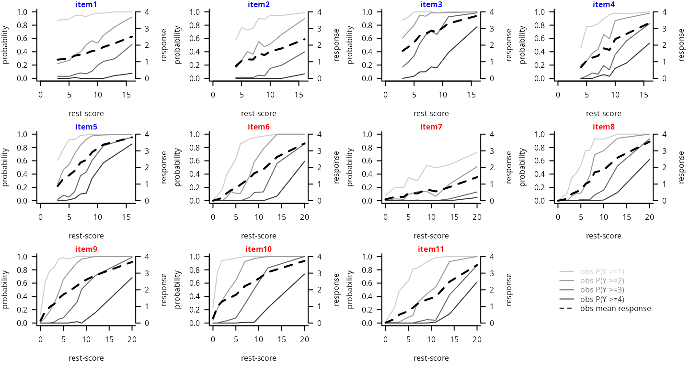

### → Results over replicates

The final structure is determined after the aggregation over replicates.
Items consistently assigned to the same subdimension are assigned to it.
Items repeatedly unassigned to any subdimension are excluded from the
analysis as they provide no additional information. Items straddling two
subdimensions are reviewed and assigned based on their clinical
relevance and subdimension loadings.

``` r
REPL <- list(NULL)

for(r in 1:R){ # for each replicate
  
  set.seed(seeds[r]) # seed

  # random selection of one visit per patient
  select <- sapply(X=table(data$ID), 
                   FUN=function(x){sample(1:x,size=1)})
  data_r <- data[which(data$ID==1),][select[1],]
  for(i in 2:N)
    data_r <- rbind(data_r,data[which(data$ID==i),][select[i],])

  # item contributions
  pc <- hetcor(data_r[,c(paste("item",1:K,sep=""))], ML=TRUE)   
  efa2 <- fa(r=pc$correlations, nfactors=2, rotate="varimax")

  contrib2 <- data.frame(ITEM = paste("item",1:K,sep=""),
                         FACT1 = efa2$loadings[,2],
                         FACT2 = efa2$loadings[,1])
  contrib2$max_loading <- apply(X=contrib2[,-1],MARGIN=1,FUN=max)
  contrib2$FACTOR <- ifelse(contrib2$max_loading == contrib2$FACT1,1,2)
  contrib2$FACTOR[which(contrib2$max_loading<.3)] <- NA

  # save
  REPL[[r]]$contrib <- contrib2
  if(r != R)
    REPL <- c(REPL,list(NULL))
}
```

``` r
par(mfrow=c(1,2),mar=c(4.5,4,.5,1),cex=.8)

# order : per replicates
contrib <- sapply(REPL, function(x) x$contrib$FACTOR)
plot(contrib, col = c("blue","red"), 
     key = NULL, xlab = "replicates", ylab = "item", main ="", las = 1)

# order : per percentage % over replicates
contrib_bydim <- t(apply(contrib,1,function(x){table(factor(x,levels=1:2))}))
contrib_bydim_matrix <- t(apply(contrib_bydim,1,function(x){rep.int(1:2,times=x)}))

plot(contrib_bydim_matrix, col = c("blue","red"), 
     key = NULL, polygon.cell = list(border=FALSE), axis.col = NULL, 
     xlab = "percentage of replicates", ylab = "item", main ="", las = 1)
segments(x0=.5, y0=seq(from=.5,to=K+.5,by=1), x1=75.5, y1=seq(from=.5,to=K+.5,by=1))
segments(x0=R+.5, y0=.5, x1=R+.5, y1=K+.5)
axis(1,line=0,lwd=1,labels=c("0%","25%","50%","75%","100%"),
     at=c(0,R/4,R/2,R*3/4,R)+.5,cex.axis=1)
```

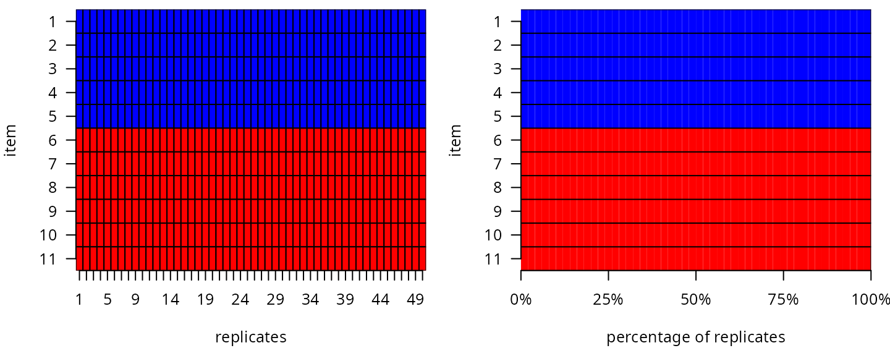

Final item assignment:

``` r
# dimension 1
item_num_d1 <- 1:5
item_lab_d1 <- paste("item",item_num_d1,sep="")
ni1 <- length(item_num_d1)
dim_col_d1 <- "blue"
item_col_d1 <- paletteer::paletteer_c("ggthemes::Green-Blue Diverging",n=ni1)

# dimension 2
item_num_d2 <- 6:11
item_lab_d2 <- paste("item",item_num_d2,sep="")
ni2 <- length(item_num_d2)
dim_col_d2 <- "red"
item_col_d2 <- paletteer::paletteer_c("ggthemes::Sunset-Sunrise Diverging",n=ni2+1)[-1] 
```

## STEP 2 - Sequencing

**Description of each subdimension progression**

The trajectory of each dimension continuum underlying the repeated item
data is modeled over time from the repeated item data using a **joint
Item Response Theory (IRT) model** adapted to ordinal repeated measures
and time-to-event data \[2\]. The model is composed of a longitudinal
submodel and a survival submodel. The parameter are simultaneously
estimated by maximum likelihood using the R-package **JLPM** (available
on CRAN and <https://github.com/VivianePhilipps/JLPM>).

The longitudinal submodel combines: - a linear mixed **structural
model** to describe the underlying dimension deterioration over time
according to covariates and functions of time, the fixed effects
defining the mean dimension trajectory at the population level and
individual correlated random effects capturing individual deviations; -
an item-specific cumulative probit **measurement model** to define the
link between the underlying dimension and each item observation. The
**survival submodel** is a proportional hazard survival model (or a
cause-specific proportional hazard model in case of competing causes)
adjusted for the current underlying dimension level as a linear
predictor to account for the informative dropout induced by the event.

For further details, please refer to Saulnier et al. \[2\].

### Estimation of each dimension trajectory using JLPM

``` r
# Dimension 1
D1 <- jointLPM(fixed = item1 + item2 + item3 + item4 + item5 ~ t,
               random = ~ 1 + t,
               survival = Surv(T, D) ~ 1,
               sharedtype = "CL",
               var.time = "t",
               subject = "ID",
               data = data,
               link = "thresholds",
               methInteg = "QMC",
               nMC = 1000,
               nproc = 20,
               verbose = T)

# Dimension 2
D2 <- jointLPM(fixed = item6 + item7 + item8 + item9 + item10 + item11 ~ t,
               random = ~ 1 + t,
               survival = Surv(T, D) ~ 1,
               sharedtype = "CL",
               var.time = "t",
               subject = "ID",
               data = data,
               link = "thresholds",
               methInteg = "QMC",
               nMC = 1000,
               nproc = 20,
               verbose = T)
```

The summary of the estimation for dimension 1:

``` r
sumD1 <- summary(D1)
#> Joint latent process model with shared random effects 
#>      fitted by maximum likelihood method 
#>  
#> jointLPM(fixed = item1 + item2 + item3 + item4 + item5 ~ t + 
#>     X, random = ~1 + t, subject = "ID", link = "thresholds", 
#>     var.time = "t", survival = Surv(T, D) ~ 1, sharedtype = "CL", 
#>     methInteg = "QMC", nMC = 1000, data = data, verbose = T, 
#>     nproc = 20)
#>  
#> Statistical Model: 
#>      Dataset: data 
#>      Number of subjects: 700 
#>      Number of observations: 13810 
#>      Number of parameters: 32  
#>      Event 1 : 
#>         Number of events: 464
#>         Weibull baseline risk function 
#>      Link functions: Thresholds for item1 
#>                      Thresholds for item2 
#>                      Thresholds for item3 
#>                      Thresholds for item4 
#>                      Thresholds for item5 
#>  
#> Iteration process: 
#>      Convergence criteria satisfied 
#>      Number of iterations:  4 
#>      Convergence criteria: parameters= 1.7e-08 
#>                          : likelihood= 3.6e-07 
#>                          : second derivatives= 8.2e-11 
#>  
#> Goodness-of-fit statistics: 
#>      maximum log-likelihood: -16231.87  
#>      AIC: 32527.74  
#>      BIC: 32673.38  
#>  
#> Maximum Likelihood Estimates: 
#>  
#> 
#> Parameters in the proportional hazard model:
#> 
#> 
#>                              coef      Se    Wald p-value
#> event1 +/-sqrt(Weibull1)  0.31613 0.01550  20.398 0.00000
#> event1 +/-sqrt(Weibull2)  1.15113 0.02870  40.106 0.00000
#> event1 asso               0.39395 0.03732  10.555 0.00000
#> 
#> Fixed effects in the longitudinal model:
#> 
#>                              coef      Se   Wald p-value
#> intercept (not estimated) 0.00000                       
#> t                         0.63009 0.02656 23.721       0
#> X                         0.60313 0.08940  6.747       0
#> 
#> 
#> Variance-covariance matrix of the random-effects:
#> (the variance of the first random effect is not estimated)
#>           intercept       t
#> intercept   1.00000        
#> t           0.06043 0.07343
#> 
#>                                                                      
#> Residual standard error:  2.46010  1.70044  1.13274  1.25940  0.75608
#> 
#> Parameters of the link functions:
#> 
#>                   coef      Se    Wald p-value
#> item1-Thresh1 -3.08760 0.21383 -14.440 0.00000
#> item1-Thresh2  2.11197 0.05450  38.749 0.00000
#> item1-Thresh3  1.74954 0.04614  37.921 0.00000
#> item1-Thresh4  2.01711 0.07142  28.242 0.00000
#> item2-Thresh1 -0.84647 0.10575  -8.004 0.00000
#> item2-Thresh2  1.42757 0.03436  41.548 0.00000
#> item2-Thresh3  1.67334 0.03765  44.439 0.00000
#> item2-Thresh4  1.54248 0.05060  30.485 0.00000
#> item3-Thresh1 -2.27635 0.13792 -16.505 0.00000
#> item3-Thresh2  1.22059 0.03988  30.609 0.00000
#> item3-Thresh3  1.32714 0.02911  45.598 0.00000
#> item3-Thresh4  1.41237 0.02955  47.799 0.00000
#> item4-Thresh1 -0.57702 0.09153  -6.304 0.00000
#> item4-Thresh2  1.19117 0.02843  41.892 0.00000
#> item4-Thresh3  1.35640 0.02927  46.344 0.00000
#> item4-Thresh4  1.14864 0.03154  36.414 0.00000
#> item5-Thresh1 -0.98000 0.08899 -11.012 0.00000
#> item5-Thresh2  1.02761 0.02667  38.537 0.00000
#> item5-Thresh3  1.22231 0.02423  50.454 0.00000
#> item5-Thresh4  0.97984 0.02389  41.011 0.00000
```

The summary of the estimation for dimension 2:

``` r
sumD2 <- summary(D2)
#> Joint latent process model with shared random effects 
#>      fitted by maximum likelihood method 
#>  
#> jointLPM(fixed = item6 + item7 + item8 + item9 + item10 + item11 ~ 
#>     t + X, random = ~1 + t, subject = "ID", link = "thresholds", 
#>     var.time = "t", survival = Surv(T, D) ~ 1, sharedtype = "CL", 
#>     methInteg = "QMC", nMC = 1000, data = data, verbose = T, 
#>     nproc = 20)
#>  
#> Statistical Model: 
#>      Dataset: data 
#>      Number of subjects: 700 
#>      Number of observations: 16572 
#>      Number of parameters: 37  
#>      Event 1 : 
#>         Number of events: 464
#>         Weibull baseline risk function 
#>      Link functions: Thresholds for item6 
#>                      Thresholds for item7 
#>                      Thresholds for item8 
#>                      Thresholds for item9 
#>                      Thresholds for item10 
#>                      Thresholds for item11 
#>  
#> Iteration process: 
#>      Convergence criteria satisfied 
#>      Number of iterations:  19 
#>      Convergence criteria: parameters= 6e-07 
#>                          : likelihood= 4.7e-06 
#>                          : second derivatives= 6.5e-11 
#>  
#> Goodness-of-fit statistics: 
#>      maximum log-likelihood: -14799.97  
#>      AIC: 29673.93  
#>      BIC: 29842.32  
#>  
#> Maximum Likelihood Estimates: 
#>  
#> 
#> Parameters in the proportional hazard model:
#> 
#> 
#>                              coef      Se    Wald p-value
#> event1 +/-sqrt(Weibull1)  0.44641 0.00615  72.574 0.00000
#> event1 +/-sqrt(Weibull2)  1.29859 0.02353  55.196 0.00000
#> event1 asso              -0.01357 0.01160  -1.170 0.24219
#> 
#> Fixed effects in the longitudinal model:
#> 
#>                              coef      Se    Wald p-value
#> intercept (not estimated)  0.0000                        
#> t                          0.3428 0.02318  14.790       0
#> X                         -1.4601 0.09006 -16.212       0
#> 
#> 
#> Variance-covariance matrix of the random-effects:
#> (the variance of the first random effect is not estimated)
#>           intercept       t
#> intercept   1.00000        
#> t          -0.06283 0.78462
#> 
#>                                                                               
#> Residual standard error:  0.88536  3.29900  0.82149  0.75795  0.76588  1.00140
#> 
#> Parameters of the link functions:
#> 
#>                    coef      Se    Wald p-value
#> item6-Thresh1  -1.68561 0.09391 -17.949 0.00000
#> item6-Thresh2   1.28457 0.02639  48.679 0.00000
#> item6-Thresh3   1.29734 0.02879  45.069 0.00000
#> item6-Thresh4   1.24227 0.03633  34.190 0.00000
#> item7-Thresh1   0.57587 0.11635   4.950 0.00000
#> item7-Thresh2   1.73585 0.04668  37.183 0.00000
#> item7-Thresh3   1.95502 0.05996  32.606 0.00000
#> item7-Thresh4   1.96940 0.10230  19.251 0.00000
#> item8-Thresh1  -1.47240 0.08953 -16.446 0.00000
#> item8-Thresh2   1.01958 0.02431  41.934 0.00000
#> item8-Thresh3   1.28883 0.02726  47.275 0.00000
#> item8-Thresh4   1.25019 0.03362  37.182 0.00000
#> item9-Thresh1  -2.77919 0.11681 -23.793 0.00000
#> item9-Thresh2   1.21222 0.02673  45.355 0.00000
#> item9-Thresh3   1.26731 0.02541  49.874 0.00000
#> item9-Thresh4   1.38766 0.03047  45.547 0.00000
#> item10-Thresh1 -3.08263 0.12574 -24.517 0.00000
#> item10-Thresh2  1.20329 0.02825  42.593 0.00000
#> item10-Thresh3  1.29967 0.02559  50.793 0.00000
#> item10-Thresh4  1.39343 0.02976  46.820 0.00000
#> item11-Thresh1 -1.72377 0.09555 -18.040 0.00000
#> item11-Thresh2  1.36617 0.02753  49.618 0.00000
#> item11-Thresh3  1.27646 0.02965  43.052 0.00000
#> item11-Thresh4  1.11695 0.03613  30.918 0.00000
```

### Predicted items’ trajectories over time

``` r
## Conversion JLPM -> multlcmm
# extracting only the longitudinal submodel (necessary for predictions)
d1 <- convert(object=D1,to="multlcmm")
d2 <- convert(object=D2,to="multlcmm")

## Predicted values of the items over a grid of times
time <- seq(0,10,1); nt <- length(time)
# Dimension 1
pred_D1 <- predictY(x=d1,
                    newdata=data.frame(t=time,X=0),
                    var.time="t",
                    methInteg=1,nsim=1000)
# Dimension 2
pred_D2 <- predictY(x=d2,
                    newdata=data.frame(t=time,X=0),
                    var.time="t",
                    methInteg=1,nsim=1000)

## Plots
generate_gradient <- function(color1, color2, n) {
  color_palette <- colorRampPalette(c(color1, color2))
  return(color_palette(n))
}

par(mfcol=c(2,2),cex=1)

# PREDICTED TRAJECTORIES

# dimension 1
par(mar=c(4.5,4,1,1)) 
plot(x = pred_D1$times$t, y = pred_D1$pred$Ypred[which(pred_D1$pred$Yname==item_lab_d1[1])], 
     col = item_col_d1[1], lwd = 2, type = "l", xlim = range(time), ylim = c(0,nl-1), 
     bty = "n", xlab = "Time", ylab = "Item level", main = "Dimension 1", col.main = "blue")
for(i in 2:ni1)
  lines(x = pred_D1$times$t, y = pred_D1$pred$Ypred[which(pred_D1$pred$Yname==item_lab_d1[i])], 
        col = item_col_d1[i], lty = 1, lwd = 2)
legend(x = "bottomright", lty = 1, lwd = 1, col = item_col_d1[1:ni1], legend = item_lab_d1, 
       bty = "n", cex = .8, ncol = 2)

# dimension 2
par(mar=c(4.5,4,1,1)) 
plot(x = pred_D2$times$t, y = pred_D2$pred$Ypred[which(pred_D2$pred$Yname==item_lab_d2[1])], 
     col = item_col_d2[5], lwd = 2, type = "l", xlim = range(time), ylim = c(0,nl-1), 
     bty = "n", xlab = "Time", ylab = "Item level", main = "Dimension 2", col.main = "red")
for(i in 2:ni2)
  lines(x = pred_D2$times$t, y = pred_D2$pred$Ypred[which(pred_D2$pred$Yname==item_lab_d2[i])], 
        col = item_col_d2[i], lty = 1, lwd = 2)
legend(x = "bottomright", lty = 1, lwd = 2, col = item_col_d2, legend = item_lab_d2, 
       bty = "n", cex = .8, ncol = 2)

# SPIDERCHART

# dimension 1
time_col <- generate_gradient(color1="white",color2="blue",n=nt+1)[-1]
time_col_rgb <- col2rgb(time_col, alpha = TRUE)
time_col_alpha <- rgb(time_col_rgb[1,],time_col_rgb[2,],time_col_rgb[3,],
                      time_col_rgb[4,]*0.3, maxColorValue = 255)

par(mar=c(3,0,0,0))
radarchart(df = data.frame(rbind(rep(0, ni1), 
                                 rep(nl-1, ni1),
                                 matrix(pred_D1$pred$Ypred,nrow=nt)))[,c(1,ni1:2)],
           cglty = 1, cglcol = "dimgray",
           seg = nl-1, centerzero = TRUE,
           plty = 1, pcol = time_col, plwd = 2, 
           vlabels = item_lab_d1[c(1,ni1:2)],
           pfcol=time_col_alpha)  
par(xpd=T)
legend(x=-1.8,y=-1.5, horiz = T, legend = time, title = "Year(s)",
       bty = "n", pch = 20, col = time_col, text.col = "black", cex = .6)

# dimension 2
time_col <- generate_gradient(color1="white",color2="red",n=nt+1)[-1]
time_col_rgb <- col2rgb(time_col, alpha = TRUE)
time_col_alpha <- rgb(time_col_rgb[1,],time_col_rgb[2,],time_col_rgb[3,],
                      time_col_rgb[4,]*0.3, maxColorValue = 255)

par(mar=c(3,0,0,0))
radarchart(df = data.frame(rbind(rep(0, ni2), 
                                 rep(nl-1, ni2),
                                 matrix(pred_D2$pred$Ypred,nrow=nt)))[,c(1,ni2:2)],
           cglty = 1, cglcol = "dimgray",
           seg = nl-1, centerzero = TRUE,
           plty = 1, pcol = time_col, plwd = 2, 
           vlabels = item_lab_d2[c(1,ni2:2)],
           pfcol=time_col_alpha)  
par(xpd=T)
legend(x=-1.8,y=-1.5, horiz = T, legend = time, title = "Year(s)",
       bty = "n", pch = 20, col = time_col, text.col = "black", cex = .6)
```

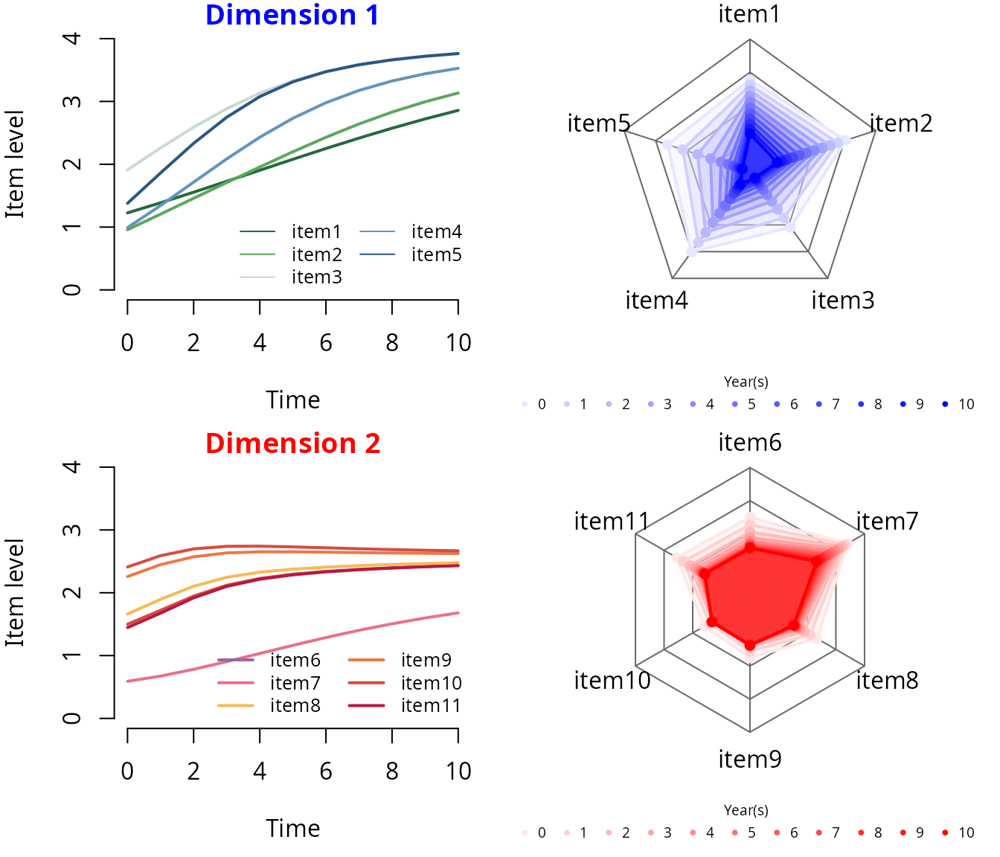

### Sequence of items’ impairment according to the dimension continuum

``` r
par(mfrow=c(1,2))

## dimension 1
level_col_d1 <- generate_gradient(color1="white", color2="blue", n=nl+1)[-1]

# item thresholds
thres1 <- D1$thres
thres1_bounds <- range(thres1)
# item discrimination
discrim1 <- D1$discrim
# covariate effects
varexp1 <- as.data.frame(sumD1$mixedModel)$coef[-1]
varexp1_lab <- paste(row.names(sumD1$mixedModel),
                     " (",ifelse(as.data.frame(sumD1$mixedModel)$'p-value'==0,
                                 "<0.001",
                                 as.data.frame(sumD1$mixedModel)$'p-value'),")",sep="")[-1]

# plot
par(mar = c(0,.5,2,.5))
p <- ni1; ext <- .75
plot(y = rep(p,2), x = c(thres1_bounds[1]-ext,thres1[1,item_lab_d1[1]]), 
     lwd = 30, type = "l", col = level_col_d1[1], 
     xlim = thres1_bounds + c(-1,1)*ext, ylim = c(-1.2, 6.5),
     xlab = "", ylab = "", main = "Dimension 1", col.main = "blue", 
     yaxt = "n", bty = "l", legend = NULL, cex.lab=1.5, cex.axis=1.5, axes = F)
for(i in 1:ni1){
  lines(y = rep(p,2), x = c(thres1_bounds[1]-ext,thres1[1,item_lab_d1[i]]), 
        lwd = 30, col = level_col_d1[1])
  for(m in 1:(nl-2))
    lines(y = rep(p,2), x = thres1[m:(m+1),item_lab_d1[i]], 
          lwd = 30, col = level_col_d1[m+1])
  lines(y = rep(p,2), x = c(thres1[nl-1,item_lab_d1[i]],thres1_bounds[2]+ext),
        lwd = 30, col = level_col_d1[nl])
  p <- p-1
}
mtext(text = item_lab_d1, side=4, at = ni1:1, line = -18, cex = 1, las=1, font = 1, col="white")
# varexp
p <-  thres1_bounds[1]; deb <- 0
rect(xleft = rep(p,length(varexp1)), xright = p+varexp1, 
     ybottom = deb-0.15-(1:length(varexp1)-1)*.8, ytop = deb+0.15-(1:length(varexp1)-1)*.8, 
     col = "black")
lines(x = rep(p,2), y = c(deb+0.35,deb-0.35-(length(varexp1)-1)), 
      lty = 3, lwd = 2, col = "darkgrey")
p <- p + ifelse(varexp1<0,0,varexp1) + 0.05
text(x = p, y = -seq(from=0,to=length(varexp1)-1,by=0.8)+deb, 
     pos = 4, labels = varexp1_lab, cex = .8)    


## dimension 2
level_col_d2 <- generate_gradient(color1="white", color2="red", n=nl+1)[-1]

# item thresholds
thres2 <- D2$thres
thres2_bounds <- range(thres2)
# item discrimination
discrim2 <- D2$discrim
# covariate effects
varexp2 <- as.data.frame(sumD2$mixedModel)$coef[-1]
varexp2_lab <- paste(row.names(sumD2$mixedModel),
                     " (",ifelse(as.data.frame(sumD2$mixedModel)$'p-value'==0,
                                 "<0.001",
                                 as.data.frame(sumD2$mixedModel)$'p-value'),")",sep="")[-1]

# plot
par(mar = c(0,.5,2,.5))
p <- ni2; ext <- .75
plot(y = rep(p,2), x = c(thres2_bounds[1]-ext,thres2[1,item_lab_d2[1]]), 
     lwd = 30, type = "l", col = level_col_d2[1], 
     xlim = thres2_bounds + c(-1,1)*ext, ylim = c(-1.2, 6.5),
     xlab = "", ylab = "", main = "Dimension 2", col.main = "red", 
     yaxt = "n", bty = "l", legend = NULL, cex.lab=1.5, cex.axis=1.5, axes = F)
for(i in 1:ni2){
  lines(y = rep(p,2), x = c(thres2_bounds[1]-ext,thres2[1,item_lab_d2[i]]), 
        lwd = 30, col = level_col_d2[1])
  for(m in 1:(nl-2))
    lines(y = rep(p,2), x = thres2[m:(m+1),item_lab_d2[i]], 
          lwd = 30, col = level_col_d2[m+1])
  lines(y = rep(p,2), x = c(thres2[nl-1,item_lab_d2[i]],thres2_bounds[2]+ext), 
        lwd = 30, col = level_col_d2[nl])
  p <- p-1
}
mtext(text = item_lab_d2, side=4, at = ni2:1, line = -18, cex = 1, las=1, font = 1, col="white")
# varexp
p <-  thres2_bounds[1]; deb <- 0
rect(xleft = rep(p,length(varexp2)), xright = p+varexp2, 
     ybottom = deb-0.15-(1:length(varexp2)-1)*.8, ytop = deb+0.15-(1:length(varexp2)-1)*.8, 
     col = "black")
lines(x = rep(p,2), y = c(deb+0.35,deb-0.35-(length(varexp2)-1)), 
      lty = 3, lwd = 2, col = "darkgrey")
p <- p + ifelse(varexp2<0,0,varexp2) + 0.05
text(x = p, y = -seq(from=0,to=length(varexp2)-1,by=0.8)+deb, 
     pos = 4, labels = varexp2_lab, cex = .8)    
```

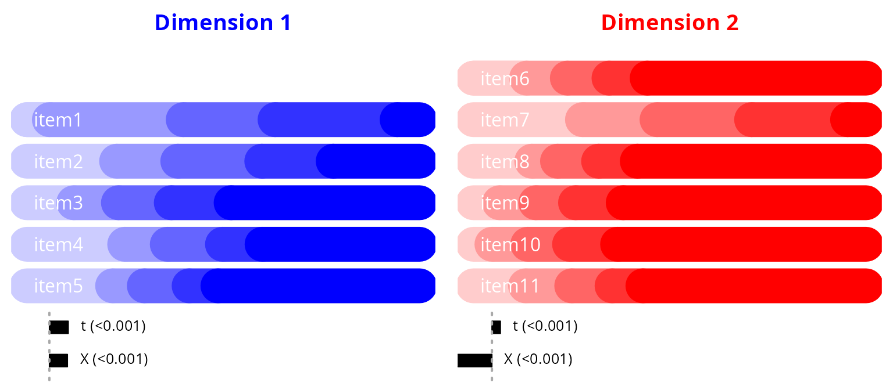

## STEP 3 - Staging

**Alignment of each subdimension’s progression with disease stages**

The disease stages are projected onto the dimension continuum using a
joint bivariate model that estimates the link between the disease stages
and the dimension total sumscore. This can be performed using again the
R-package **JLPM**, also adapted to treat continuous markers by
replacing the cumulative probit measurement models by linear and
curvilinear measurement models (the curvilinear model involves a
parameterized bijective link function approximated by splines which
captures the departure from normality of the variable) \[2\]. Then,
thresholds (on the dimension continuum) that correspond to the disease
stages can be deduced by predicting the dimension sumscores that
correspond to a change of disease stage and expressing them in the
dimension process scale. Note that, as this part requires the
computation of dimension sumscores, visits with more than 25% of missing
items are omitted.

### Estimation of the proxy model

``` r
data$D1_score <- rowSums(data[,item_lab_d1])
data$D2_score <- rowSums(data[,item_lab_d2])
```

``` r
# dimension 1
D1ss <- jointLPM(fixed = D1_score + stage ~ t,
                 random = ~ 1 + t,
                 survival = Surv(T, D) ~ 1,
                 sharedtype = "CL",
                 var.time = "t",
                 subject = "ID",
                 data = data,
                 link = c("5-quant-splines","thresholds"),
                 methInteg = "QMC",
                 nMC = 1000,
                 nproc = 20,
                 verbose = T)

# dimension 2
D2ss <- jointLPM(fixed = D2_score + stage ~ t,
                 random = ~ 1 + t,
                 survival = Surv(T, D) ~ 1,
                 sharedtype = "CL",
                 var.time = "t",
                 subject = "ID",
                 data = data,
                 link = c("5-quant-splines","thresholds"),
                 methInteg = "QMC",
                 nMC = 1000,
                 nproc = 20,
                 verbose = T)
```

The summary of the estimation of proxy dimension 1:

``` r
summary(D1ss)
#> Joint latent process model with shared random effects 
#>      fitted by maximum likelihood method 
#>  
#> jointLPM(fixed = D1_score + stage ~ t, random = ~1 + t, subject = "ID", 
#>     link = c("5-quant-splines", "thresholds"), var.time = "t", 
#>     survival = Surv(T, D) ~ 1, sharedtype = "CL", methInteg = "QMC", 
#>     nMC = 1000, data = data, verbose = T, nproc = 20)
#>  
#> Statistical Model: 
#>      Dataset: data 
#>      Number of subjects: 700 
#>      Number of observations: 5524 
#>      Number of parameters: 19  
#>      Event 1 : 
#>         Number of events: 464
#>         Weibull baseline risk function 
#>      Link functions: Quadratic I-splines with nodes 0 7 10 13 20 for D1_score 
#>                      Thresholds for stage 
#>  
#> Iteration process: 
#>      Convergence criteria satisfied 
#>      Number of iterations:  15 
#>      Convergence criteria: parameters= 3.4e-08 
#>                          : likelihood= 1.6e-07 
#>                          : second derivatives= 6.4e-14 
#>  
#> Goodness-of-fit statistics: 
#>      maximum log-likelihood: -11440.53  
#>      AIC: 22919.06  
#>      BIC: 23005.53  
#>  
#> Maximum Likelihood Estimates: 
#>  
#> 
#> Parameters in the proportional hazard model:
#> 
#> 
#>                              coef      Se    Wald p-value
#> event1 +/-sqrt(Weibull1)  0.32144 0.01532  20.978 0.00000
#> event1 +/-sqrt(Weibull2)  1.13243 0.02953  38.353 0.00000
#> event1 asso               0.46219 0.04344  10.640 0.00000
#> 
#> Fixed effects in the longitudinal model:
#> 
#>                              coef      Se Wald p-value
#> intercept (not estimated) 0.00000                     
#> t                         0.60412 0.02823 21.4       0
#> 
#> 
#> Variance-covariance matrix of the random-effects:
#> (the variance of the first random effect is not estimated)
#>           intercept       t
#> intercept   1.00000        
#> t           0.05106 0.05986
#> 
#>                                           
#> Residual standard error:  0.64210  4.57294
#> 
#> Parameters of the link functions:
#> 
#>                         coef      Se    Wald p-value
#> D1_score-I-splines1 -3.29981 0.17375 -18.992 0.00000
#> D1_score-I-splines2  1.13156 0.08750  12.932 0.00000
#> D1_score-I-splines3  1.15979 0.05946  19.507 0.00000
#> D1_score-I-splines4  1.28021 0.03743  34.200 0.00000
#> D1_score-I-splines5  1.25577 0.04001  31.388 0.00000
#> D1_score-I-splines6  1.16593 0.06690  17.428 0.00000
#> D1_score-I-splines7  1.47776 0.08699  16.989 0.00000
#> stage-Thresh1       -5.48493 0.49155 -11.158 0.00000
#> stage-Thresh2        2.06206 0.08445  24.418 0.00000
#> stage-Thresh3        1.55126 0.06492  23.897 0.00000
#> stage-Thresh4        2.08718 0.08252  25.293 0.00000
```

The summary of the estimation of proxy dimension 2:

``` r
summary(D2ss)
#> Joint latent process model with shared random effects 
#>      fitted by maximum likelihood method 
#>  
#> jointLPM(fixed = D2_score + stage ~ t, random = ~1 + t, subject = "ID", 
#>     link = c("5-quant-splines", "thresholds"), var.time = "t", 
#>     survival = Surv(T, D) ~ 1, sharedtype = "CL", methInteg = "QMC", 
#>     nMC = 1000, data = data, verbose = T, nproc = 20)
#>  
#> Statistical Model: 
#>      Dataset: data 
#>      Number of subjects: 700 
#>      Number of observations: 5524 
#>      Number of parameters: 19  
#>      Event 1 : 
#>         Number of events: 464
#>         Weibull baseline risk function 
#>      Link functions: Quadratic I-splines with nodes 0 4 8 13 24 for D2_score 
#>                      Thresholds for stage 
#>  
#> Iteration process: 
#>      Convergence criteria satisfied 
#>      Number of iterations:  44 
#>      Convergence criteria: parameters= 5.6e-06 
#>                          : likelihood= 1.3e-06 
#>                          : second derivatives= 6e-11 
#>  
#> Goodness-of-fit statistics: 
#>      maximum log-likelihood: -12002.19  
#>      AIC: 24042.38  
#>      BIC: 24128.85  
#>  
#> Maximum Likelihood Estimates: 
#>  
#> 
#> Parameters in the proportional hazard model:
#> 
#> 
#>                               coef      Se    Wald p-value
#> event1 +/-sqrt(Weibull1)   0.44843 0.00659  68.090 0.00000
#> event1 +/-sqrt(Weibull2)   1.29890 0.02381  54.549 0.00000
#> event1 asso               -0.01971 0.02090  -0.943 0.34572
#> 
#> Fixed effects in the longitudinal model:
#> 
#>                              coef      Se   Wald p-value
#> intercept (not estimated) 0.00000                       
#> t                         0.25992 0.02329 11.161       0
#> 
#> 
#> Variance-covariance matrix of the random-effects:
#> (the variance of the first random effect is not estimated)
#>           intercept       t
#> intercept   1.00000        
#> t           0.05058 0.29009
#> 
#>                                             
#> Residual standard error:   0.51159   8.76991
#> 
#> Parameters of the link functions:
#> 
#>                          coef      Se    Wald p-value
#> D2_score-I-splines1  -2.63468 0.10283 -25.623 0.00000
#> D2_score-I-splines2   1.16905 0.03212  36.400 0.00000
#> D2_score-I-splines3   0.76190 0.04499  16.934 0.00000
#> D2_score-I-splines4   1.03236 0.03451  29.915 0.00000
#> D2_score-I-splines5   1.38736 0.03912  35.463 0.00000
#> D2_score-I-splines6   0.61250 0.10703   5.723 0.00000
#> D2_score-I-splines7   1.76780 0.05897  29.976 0.00000
#> stage-Thresh1       -11.49613 1.29089  -8.906 0.00000
#> stage-Thresh2         2.81637 0.15640  18.007 0.00000
#> stage-Thresh3         2.12124 0.11886  17.846 0.00000
#> stage-Thresh4         2.85427 0.15446  18.478 0.00000
```

### Predicted item levels according to dimension level with disease stages

``` r
par(mfrow=c(1,2))

## dimension 1
proj1 <- IRT4Sstaging(D=D1,Dss=D1ss,nsim=10000,bounds=c(-15,15))
thres1_bounds <- range(thres1_bounds,proj1)

# plot
par(mar = c(0,.5,2,.5))
p <- ni1; ext <- 2 
plot(y = rep(p,2), x = c(thres1_bounds[1]-ext,thres1[1,item_lab_d1[1]]), 
     lwd = 30, type = "l", col = level_col_d1[1], 
     xlim = thres1_bounds+c(-1,1)*ext, ylim = c(.5, 6.5),
     xlab = "", ylab = "", main = "Dimension 1", col.main = "blue", 
     yaxt = "n", bty = "l", legend = NULL, cex.lab=1.5, cex.axis=1.5, axes = F)
for(i in 1:ni1){
  lines(y = rep(p,2), x = c(thres1_bounds[1]-ext,thres1[1,item_lab_d1[i]]), 
        lwd = 30, col = level_col_d1[1])
  for(m in 1:(nl-2))
    lines(y = rep(p,2), x = thres1[m:(m+1),item_lab_d1[i]], 
          lwd = 30, col = level_col_d1[m+1])
  lines(y = rep(p,2), x = c(thres1[nl-1,item_lab_d1[i]],thres1_bounds[2]+ext), 
        lwd = 30, col = level_col_d1[nl])
  p <- p-1
}
mtext(text = item_lab_d1, side=4, at = ni1:1, line = -18, cex = 1, las=1, font = 1, col="white")
# stages
for(j in 1:length(proj1))
  lines(x = rep(proj1[j],2), y = c(0.5,ni1+0.5), lwd = 4, col = "black")
par(xpd=TRUE)
text(y = ni1+0.8,
     x = ( c(proj1,thres1_bounds[2]+ext) - c(thres1_bounds[1]-ext,proj1) ) / 2 +
       c(thres1_bounds[1]-ext,proj1),
     labels = as.roman(1:(length(proj1)+1)), cex = 1.5, col = "black", font = 2)


## dimension 2
proj2 <- IRT4Sstaging(D=D2,Dss=D2ss,nsim=10000,bounds=c(-15,15)) 
thres2_bounds <- range(thres2_bounds,proj2)

# plot
par(mar = c(0,.5,2,.5))
p <- ni2; ext <- 2 
plot(y = rep(p,2), x = c(thres2_bounds[1]-ext,thres2[1,item_lab_d2[1]]), 
     lwd = 30, type = "l", col = level_col_d2[1], 
     xlim = thres2_bounds+c(-1,1)*ext, ylim = c(.5, 6.5),
     xlab = "", ylab = "", main = "Dimension 2", col.main = "red", 
     yaxt = "n", bty = "l", legend = NULL, cex.lab=1.5, cex.axis=1.5, axes = F)
for(i in 1:ni2){
  lines(y = rep(p,2), x = c(thres2_bounds[1]-ext,thres2[1,item_lab_d2[i]]), 
        lwd = 30, col = level_col_d2[1])
  for(m in 1:(nl-2))
    lines(y = rep(p,2), x = thres2[m:(m+1),item_lab_d2[i]], 
          lwd = 30, col = level_col_d2[m+1])
  lines(y = rep(p,2), x = c(thres2[nl-1,item_lab_d2[i]],thres2_bounds[2]+ext), 
        lwd = 30, col = level_col_d2[nl])
  p <- p-1
}
mtext(text = item_lab_d2, side=4, at = ni2:1, line = -18, cex = 1, las=1, font = 1, col="white")
# stages
for(j in 1:length(proj2))
  lines(x = rep(proj2[j],2), y = c(0.5,ni2+0.5), lwd = 4, col = "black")
par(xpd=TRUE)
text(y = ni2+0.8,
     x = ( c(proj2,thres2_bounds[2]+ext)  - c(thres2_bounds[1]-ext,proj2) ) / 2 +
       c(thres2_bounds[1]-ext,proj2),
     labels = as.roman(1:(length(proj2)+1)), cex = 1.5, col = "black", font = 2)
```

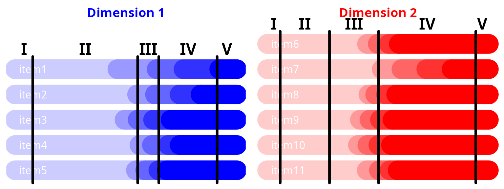

## STEP 4 - Selecting

**Identification of the most informative items across disease stages**

The contribution of each item to the underlying dimension can be
quantified by the percentage of information it carries at each stage.
The information is defined by the Fisher Information function (i.e., the
second derivative of the item probability with respect to the underlying
dimension) which is integrated over all the underlying dimension values
corresponding to a specific stage (as determined in Step 3) to obtain
the item-and-stage-specific information. The total information of a
dimension at a specific stage is then the sum of all the
item-and-stage-specific informations so that the percentage of total
information carried by an item at a disease stage can be easily deduced.

### Computation of Fisher information by stage

Information computation for dimension 1:

``` r
# dimension 1
fisher1 <- IRT4Sselecting(D=D1,proj=proj1)
lapply(X = fisher1, FUN = round, digits = 2)
#> $raw_info
#>       1    2    3    4    5
#> item1 0 0.67 0.32 0.90 0.10
#> item2 0 0.58 0.69 1.74 0.01
#> item3 0 0.62 1.54 1.64 0.00
#> item4 0 0.13 1.27 2.05 0.00
#> item5 0 0.40 3.34 2.56 0.00
#> 
#> $percent_info
#>         1     2     3     4     5
#> item1 100 27.96  4.50 10.17 90.31
#> item2   0 24.25  9.61 19.61  9.69
#> item3   0 25.77 21.56 18.41  0.00
#> item4   0  5.35 17.70 23.02  0.00
#> item5   0 16.66 46.63 28.79  0.00
```

Information computation for dimension 2:

``` r
# dimension 2
fisher2 <- IRT4Sselecting(D=D2,proj=proj2)
lapply(X = fisher2, FUN = round, digits = 2)
#> $raw_info
#>        1    2    3    4    5
#> item6  0 0.00 1.90 4.12 0.00
#> item7  0 0.01 0.26 1.09 0.01
#> item8  0 0.00 1.89 4.15 0.00
#> item9  0 0.00 4.11 3.65 0.00
#> item10 0 0.00 4.23 3.31 0.00
#> item11 0 0.00 2.20 3.37 0.00
#> 
#> $percent_info
#>          1   2     3     4   5
#> item6    0   0 13.03 20.93   0
#> item7  100 100  1.75  5.54 100
#> item8    0   0 12.94 21.07   0
#> item9    0   0 28.19 18.55   0
#> item10   0   0 29.00 16.82   0
#> item11   0   0 15.09 17.09   0
```

### Plot of item contributions by disease stage

``` r
layout.matrix <- matrix(c(1,1,4,4,
                          2,3,5,6), nrow = 2, ncol = 4, byrow = T)
layout(mat = layout.matrix,
       heights = c(6.5,3.1),
       widths = c(2.4,2.2,2.4,2.2))
par(cex=1)
spc <- 0.5 # space btw barplots

## dimension 1
# CASE 1 : info percent
par(mar=c(0.5,0.75,4,4.5)) 
barplot(height = fisher1$percent_info[ni1:1,], col = item_col_d1, border = TRUE,
        xlab = "", axes = FALSE, axisnames = FALSE, space = spc)
axis(4,line=0.5,las=1,lwd=2, labels = c("0%","25%","50%","75%","100%"),
     at=c(0,25,50,75,100),cex.axis=1,font=2)
mtext(text = as.roman(1:(length(proj1)+1)), cex = 1, side = 3, line = 0, font = 2,
      at = .5+((1:(length(proj1)+1))-1)+spc*(1:(length(proj1)+1)))
mtext(text = "Percentage of information", cex = 1, side = 3, line = 1.35, font = 1.5)
par(xpd=TRUE)
text(y = 100 + 35, x = 0.25, 
     labels = "Dimension 1", cex = 1.25, col = "blue", adj = 0, font = 2)
# CASE 2 : cumulated info percent
par(mar=c(0.5,1.5,2.2,4)) 
barplot(height = colSums(fisher1$raw_info), col = "grey", border = F,
        xlab = "", axes = FALSE, axisnames = FALSE, space = 0.2)
axis(4,line=0.5,las=1,lwd=1,labels = c(0.0,"",round(max(colSums(fisher1$raw_info)),1)),
     at=c(0,max(colSums(fisher1$raw_info))/2,max(colSums(fisher1$raw_info))),
     cex.axis=.8,font=1,col="grey",col.axis="grey")
mtext(text = as.roman(1:(length(proj1)+1)), cex = .8, side = 3, line = 0, font = 1, 
      col = "grey", at = .5+((1:(length(proj1)+1))-1)+.2*(1:(length(proj1)+1)))
mtext(text = "Total information", col = "grey", cex = .8, side = 3, line = 1, font = 1.5)
# CASE 3 : legend
par(mar=c(0,0,0,0))
plot(x = 0, y = 0, col="white", type="p", bty="n", axes = FALSE,
     xlab="",ylab="",xlim=c(0,1),ylim=c(0,1))
legend(x = 0, y = 1.1, fill = item_col_d1, border = F, 
       legend = item_lab_d1,  ncol = 1, bty = "n", cex = .8, y.intersp=1.3, x.intersp=0.5)

## dimension 2
# CASE 1 : info percent
par(mar=c(0.5,0.75,4,4.5)) 
barplot(height = fisher2$percent_info[ni2:1,], col = item_col_d2, border = TRUE,
        xlab = "", axes = FALSE, axisnames = FALSE, space = spc)
axis(4,line=0.5,las=1,lwd=2, labels = c("0%","25%","50%","75%","100%"),
     at=c(0,25,50,75,100),cex.axis=1,font=2)
mtext(text = as.roman(1:(length(proj2)+1)), cex = 1, side = 3, line = 0, font = 2,
      at = .5+((1:(length(proj2)+1))-1)+spc*(1:(length(proj2)+1)))
mtext(text = "Percentage of information", cex = 1, side = 3, line = 1.35, font = 1.5)
par(xpd=TRUE)
text(y = 100 + 35, x = 0.25, 
     labels = "Dimension 2", cex = 1.25, col = "red", adj = 0, font = 2)
# CASE 2 : cumulated info percent
par(mar=c(0.5,1.5,2.2,4)) 
barplot(height = colSums(fisher2$raw_info), col = "grey", border = F,
        xlab = "", axes = FALSE, axisnames = FALSE, space = 0.2)
axis(4,line=0.5,las=1,lwd=1,labels = c(0.0,"",round(max(colSums(fisher2$raw_info)),1)),
     at=c(0,max(colSums(fisher2$raw_info))/2,max(colSums(fisher2$raw_info))),
     cex.axis=.8,font=1,col="grey",col.axis="grey")
mtext(text = as.roman(1:(length(proj2)+1)), cex = .8, side = 3, line = 0, font = 1, 
      col = "grey", at = .5+((1:(length(proj2)+1))-1)+.2*(1:(length(proj2)+1)))
mtext(text = "Total information", col = "grey", cex = .8, side = 3, line = 1, font = 1.5)
# CASE 3 : legend
par(mar=c(0,0,0,0))
plot(x = 0, y = 0, col="white", type="p", bty="n", axes = FALSE,
     xlab="",ylab="",xlim=c(0,1),ylim=c(0,1))
legend(x = 0, y = 1.1, fill = item_col_d2, border = F, 
       legend = item_lab_d2,  ncol = 1, bty = "n", cex = .8, y.intersp=1.3, x.intersp=0.5)
```

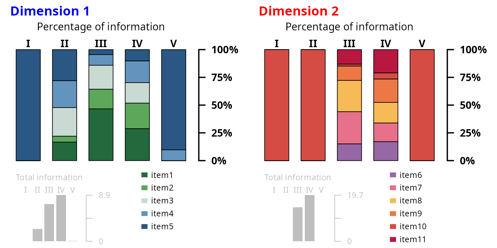

**References**

\[1\] Reeve, B. B., Hays, R. D., Bjorner, J. B., Cook, K. F., Crane, P.
K., Teresi, J. A., et al. (2007) Psychometric evaluation and calibration
of health-related quality of life item banks: plans for the
Patient-Reported Outcomes Measurement Information System (PROMIS).
Medical Care, 45:S22–31.

\[2\] Saulnier, T., Philipps, V., Meissner, W. G., Rascol, O., Pavy-Le
Traon, A., Foubert-Samier, A., and Proust-Lima, C. (2022). Joint models
for the longitudinal analysis of measurement scales in the presence of
informative dropout. Methods, 203:142–151.
